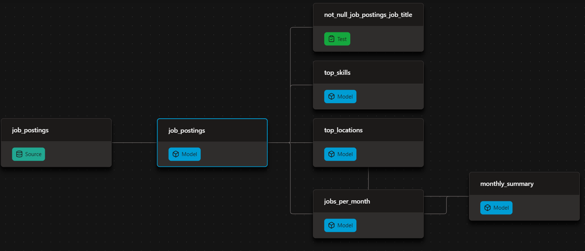

# Automated Job Postings Pipeline - dbt + DuckDB


A public dbt + DuckDB pipeline over ~692k real job postings and their ~3.3M skill tags, rebuilt and republished automatically on every push

- Models the raw postings and skills into tested, documented insight marts
- Publishes the docs site and the finished warehouse, open to anyone with no credentials
- Runs itself on GitHub Actions: every push and every Monday

Everything is free and local-friendly: DuckDB as the warehouse, GitHub Actions as the scheduler.

| What I Built | How I Implemented | Where to Look |
| --- | --- | --- |
| **dbt pipeline** | sources → cleaned models → 4 insight marts | [`analytics/models/`](analytics/models/) |
| **Data tests** | 7 tests: `unique` / `not_null` on the grain of `monthly_summary`, `top_locations` and `top_skills`, plus `not_null` on `job_title` | [`schema.yml`](analytics/models/schema.yml) |
| **Hosted dbt docs** | lineage, descriptions, column tests | [Live docs site](https://ahmedehabyoussef9-tech.github.io/dbt-duckdb-pipeline/) |
| **Public CI** | build + test + publish on every push | [Actions workflow](https://github.com/ahmedehabyoussef9-tech/dbt-duckdb-pipeline/actions/workflows/dbt_build.yml) |
| **Environments** | local `dev` vs CI `prod` targets | [`ci/profiles.yml`](ci/profiles.yml) |
| **Published warehouse** | one `ATTACH`, queryable by anyone | [Query it](#query-the-published-warehouse) |

---

## ⚙️ The dbt Pipeline

Raw postings flow through three dbt layers — declared sources → cleaned staging views → insight marts — with tests gating every build. The DAG below is the whole flow:



And the dbt features doing the work:

| dbt Feature | How I Used It |
| --- | --- |
| Declared sources (no hardcoded paths in SQL) | [`sources.yml`](analytics/models/sources.yml) + `source('raw', 'job_postings')` and `source('raw', 'job_skills')` |
| Model dependencies | `ref()` everywhere downstream; dbt resolves order and parallelism |
| Materializations | project default `table`; staging override to `view` |
| Data tests | `unique` / `not_null` on mart grains (`monthly_summary`, `top_locations`, `top_skills`) and `not_null` on `job_title` in [`schema.yml`](analytics/models/schema.yml) |
| Environments | local `dev` vs CI `prod` targets ([`ci/profiles.yml`](ci/profiles.yml)) |

`dbt build` compiles SQL, materializes models, and fails the run if any test fails — same command locally and in CI.

---

## 📊 What the marts answer

| Mart | Question it answers |
| --- | --- |
| `jobs_per_month` | How many postings are there per role each month? |
| `monthly_summary` | What is the monthly total, remote count and remote share? |
| `top_locations` | Which 10 locations have the most postings? |
| `top_skills` | Which 20 skills appear in the most postings? |

`top_skills` is the mart I added beyond the course build. It joins the skills file to the cleaned postings and counts **distinct** `job_id`s, because the same posting is scraped more than once (~692k rows, ~491k unique postings). Counting rows instead would inflate every skill.

Example result: SQL and Python each appear in more than half of the distinct postings (55.0% and 54.8%), followed by AWS (28.4%) and Azure (27.4%).

---

## 🚀 Production

GitHub Actions runs the whole pipeline — no laptop required: [`.github/workflows/dbt_build.yml`](.github/workflows/dbt_build.yml)

| Trigger | What happens |
| --- | --- |
| Push to `master` | Full rebuild |
| Weekly (Monday) | Scheduled rebuild — pipeline stays fresh |
| Manual (`workflow_dispatch`) | Run button in the Actions UI |

On each run, Actions:

1. Installs deps with `uv`
2. Downloads raw parquet
3. Runs `dbt build` with the committed CI profile (prod)
4. Publishes `prod.duckdb` as a GitHub Release asset

The badge at the top of this README links to the latest runs.

---

## 🦆 Query the published warehouse

No clone required. [Install DuckDB](https://duckdb.org/docs/installation/) (`brew install duckdb`), then from a `duckdb` session:

```sql
INSTALL httpfs;
LOAD httpfs;

ATTACH 'https://github.com/ahmedehabyoussef9-tech/dbt-duckdb-pipeline/releases/download/warehouse/prod.duckdb' AS jobs;
USE jobs;
SHOW TABLES;

SELECT * FROM top_locations;
SELECT * FROM monthly_summary;
SELECT * FROM top_skills;
```

> The database is rebuilt automatically by GitHub Actions and republished to this release URL, so the data you query is always the latest successful build.

---

## 📖 Docs

Docs are generated with `dbt docs generate` and published to GitHub Pages:

**→ [ahmedehabyoussef9-tech.github.io/dbt-duckdb-pipeline](https://ahmedehabyoussef9-tech.github.io/dbt-duckdb-pipeline/)**

The site shows:

- The full **lineage graph** (sources → models → marts)
- **Model and column descriptions** from the YAML
- Which columns carry **tests**

---

## 💻 Run it yourself

```bash
uv sync
uv run python scripts/download_data.py
cd analytics && uv run dbt build
```

Optional docs locally:

```bash
uv run dbt docs generate
uv run dbt docs serve
```

---

## 📁 Project layout

```text
.
├── .github/workflows/dbt_build.yml   # public CI: build, test, publish
├── ci/profiles.yml                   # prod DuckDB target for Actions
├── data/                             # raw + warehouses (gitignored; CI regenerates)
├── docs/                             # dbt docs site (GitHub Pages)
├── analytics/
│   ├── dbt_project.yml
│   └── models/                       # sources, staging, marts, schema.yml
└── scripts/download_data.py          # fetch raw parquet before build
```

---

*Built while following Luke Barousse's [dbt for Data Analytics & Engineering course](https://www.lukebarousse.com) (Project 1, lessons 1.01 to 2.02). Dataset: real job postings scraped daily.*